# All screenshots

Every screenshot in both themes, light on the left and dark on the right, whatever your browser's own. The [screenshots page](screenshots.md) describes each screen and shows it in the theme your browser prefers.

## Desktop

### Dashboard

<table>
  <tr>
    <td width="50%"></td>
    <td width="50%">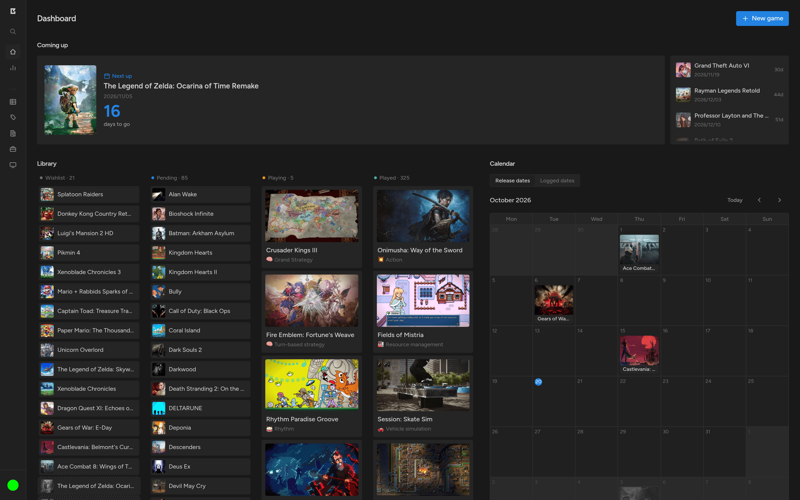</td>
  </tr>
</table>

### Stats

<table>
  <tr>
    <td width="50%"></td>
    <td width="50%">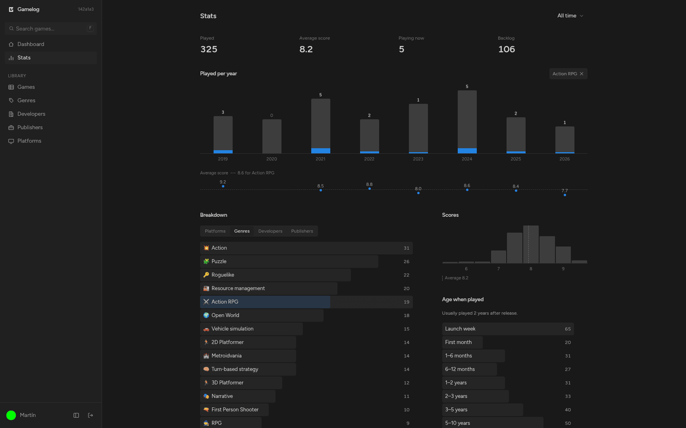</td>
  </tr>
</table>

### Games as a cover grid

<table>
  <tr>
    <td width="50%"></td>
    <td width="50%">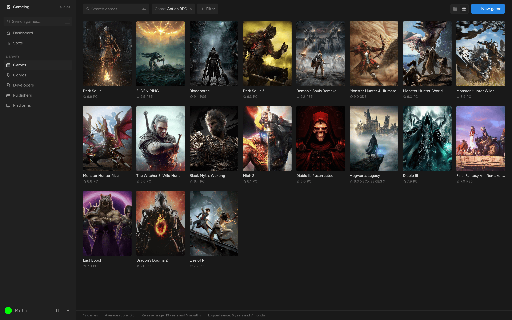</td>
  </tr>
</table>

### Games as a table

<table>
  <tr>
    <td width="50%"></td>
    <td width="50%">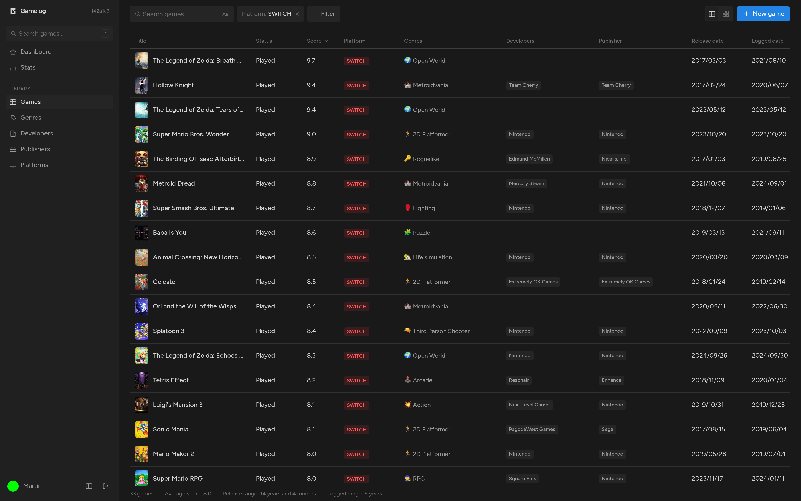</td>
  </tr>
</table>

### Editing a game

<table>
  <tr>
    <td width="50%"></td>
    <td width="50%">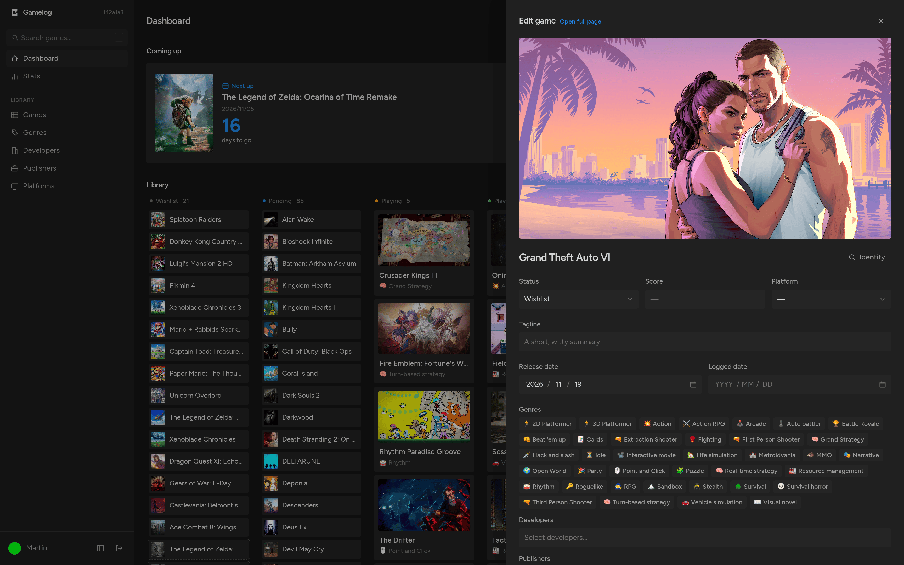</td>
  </tr>
</table>

### Genres

<table>
  <tr>
    <td width="50%"></td>
    <td width="50%">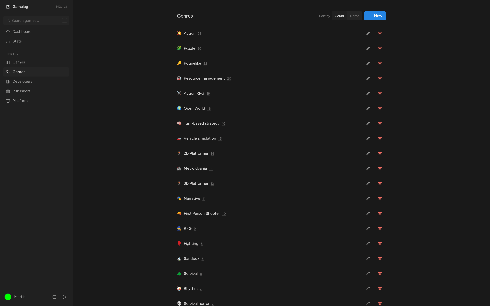</td>
  </tr>
</table>

## Mobile

Light on the top row, dark on the bottom one.

<table>
  <tr>
    <th width="33%">Games</th>
    <th width="33%">Editing a game</th>
    <th width="33%">Account</th>
  </tr>
  <tr>
    <td></td>
    <td></td>
    <td></td>
  </tr>
  <tr>
    <td>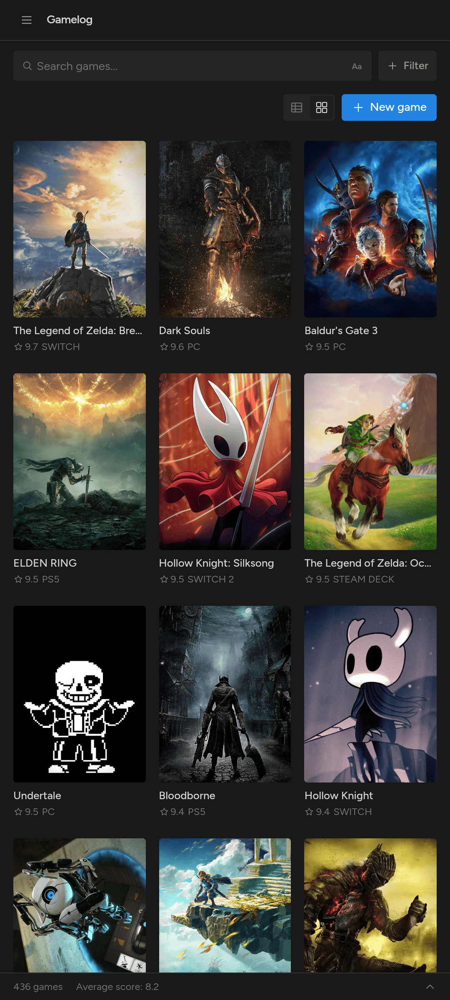</td>
    <td>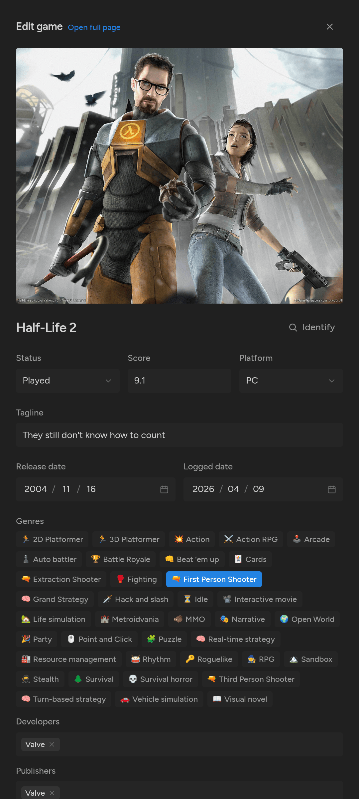</td>
    <td>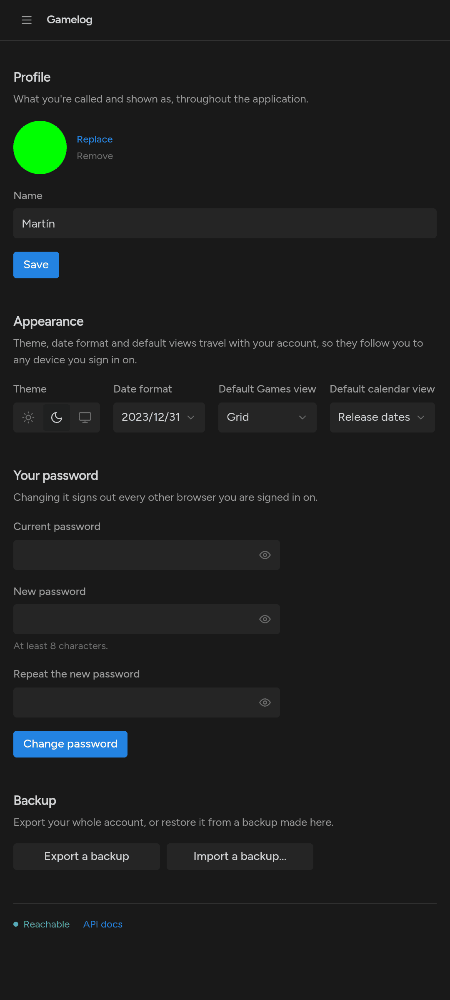</td>
  </tr>
</table>

## Hero

The image at the top of the README, built with `scripts/make-hero.sh`.

<table>
  <tr>
    <td width="50%">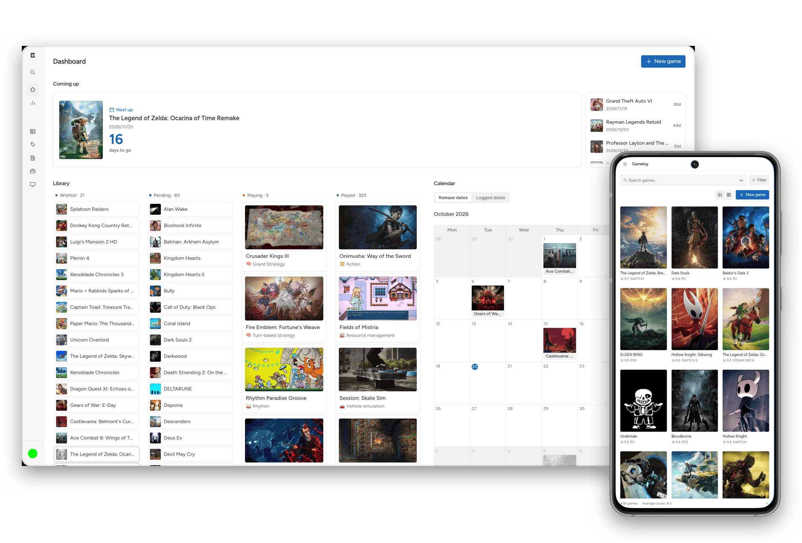</td>
    <td width="50%">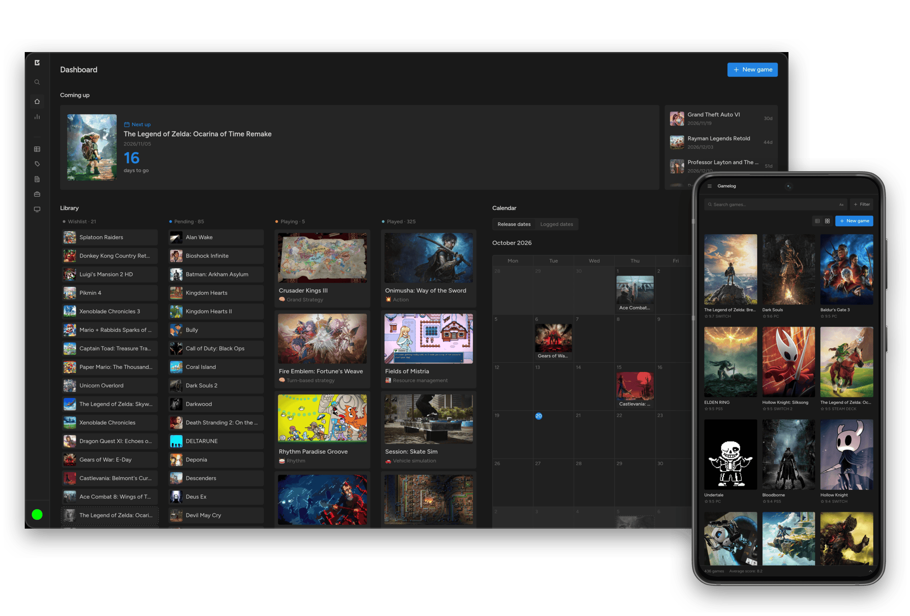</td>
  </tr>
</table>
