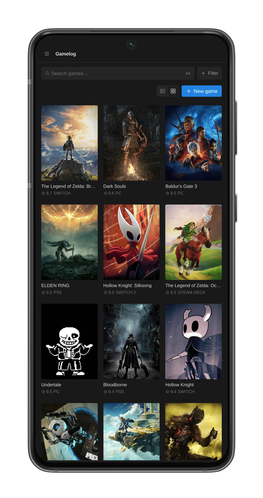
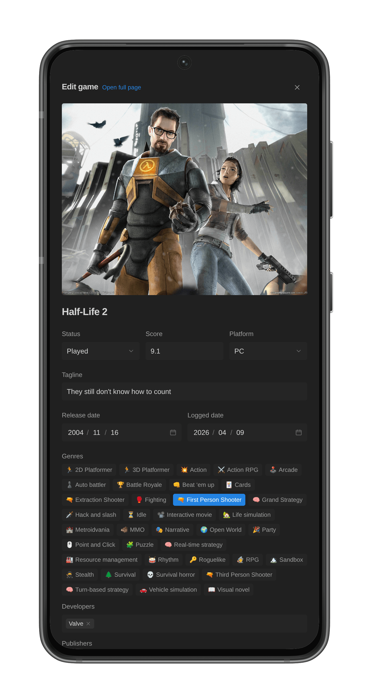
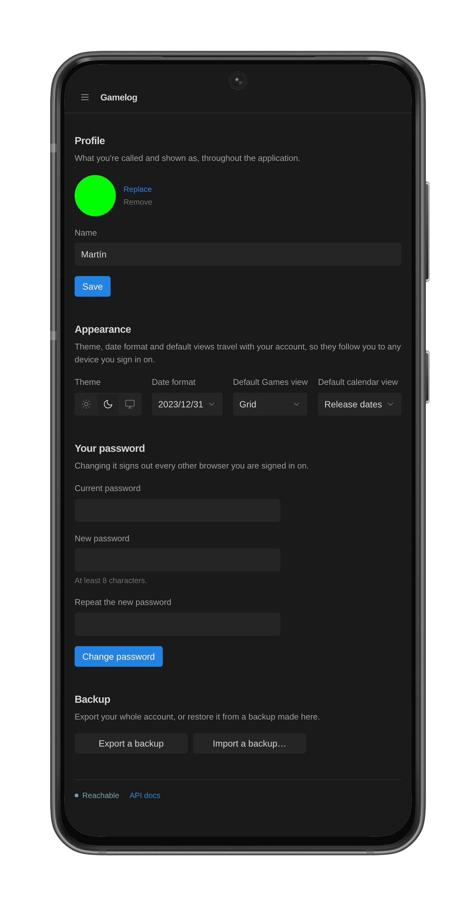

# Screenshots

A tour of the main screens, on desktop and on a phone. All of them use the dark theme.

## Desktop

### Dashboard

The home page. "Coming up" counts down to the next game due out and lists the ones after it. Below, the library is laid out as a board with one column per status (Wishlist, Pending, Playing and Played), next to a calendar of release dates.

### Games as a cover grid

The games list shown as covers, here filtered by genre, with the score and platform under each one. The footer sums up the filtered games: how many there are, their average score and the span of their release and logged dates.

### Games as a table

The same list as a table, here filtered by platform and sorted by score, with the status, genres, developers, publisher and both dates of each game.

### Editing a game

Opening a game slides in a panel over the current page, with its cover, status, score, platform, tagline, dates, genres, developers and publishers. It can also be opened as a full page.

### Genres

Genres, developers, publishers and platforms each have their own page, sorted by name or by how many games use them, where they can be added, renamed and deleted.

## Mobile

<table>
  <tr>
    <td width="33%" valign="top">
      
      
<b>Games.</b> The sidebar folds into a menu and the cover grid fits three games per row.

    </td>
    <td width="33%" valign="top">
      
      
<b>Editing a game.</b> The edit panel takes up the whole screen.

    </td>
    <td width="33%" valign="top">
      
      
<b>Account.</b> Profile, theme, date format, default views, password and backups.

    </td>
  </tr>
</table>
