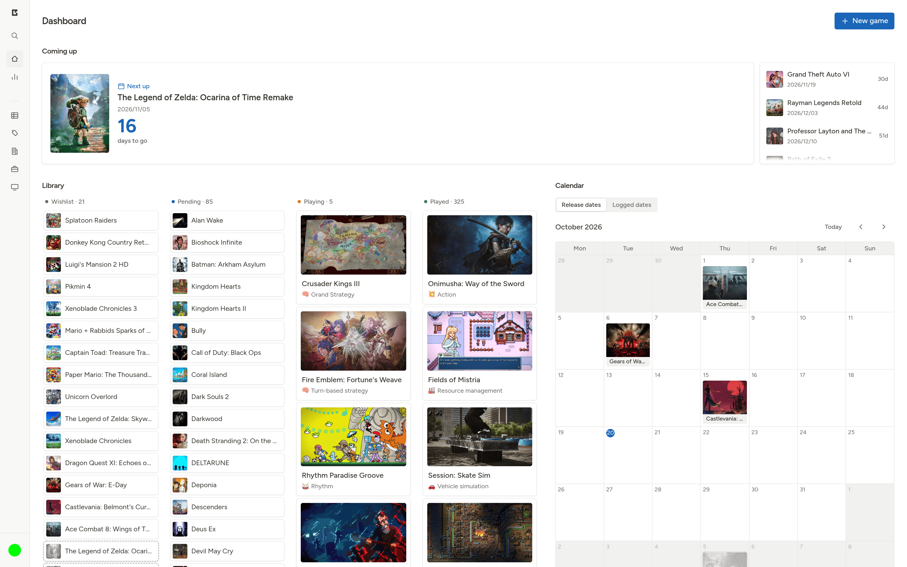
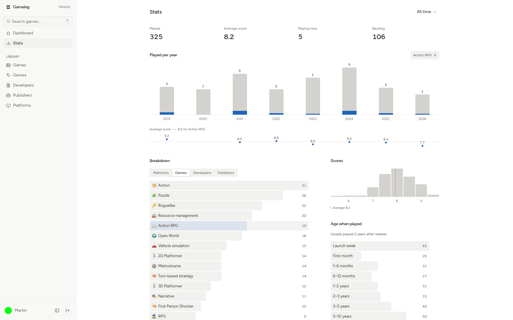
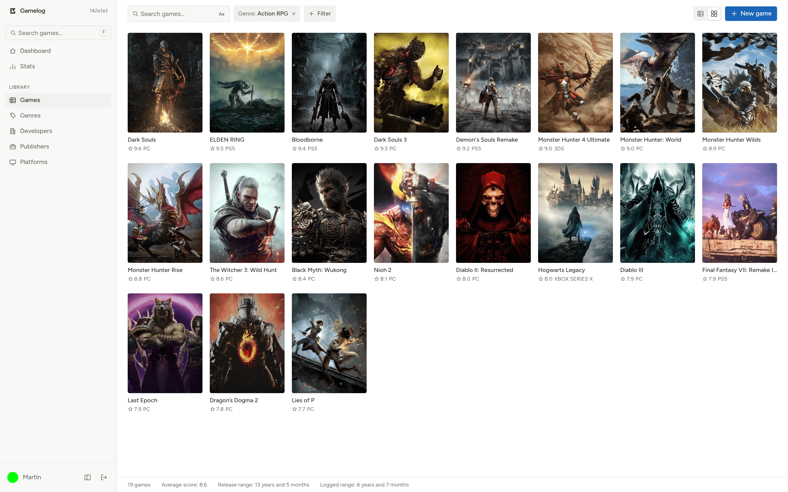
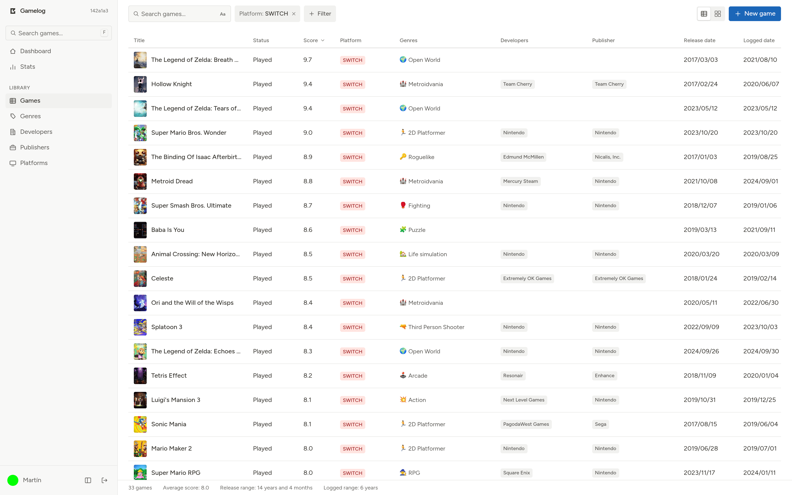
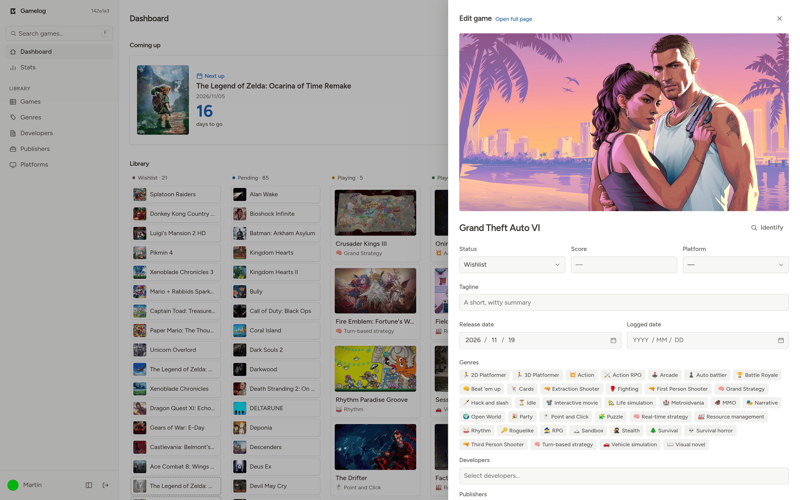
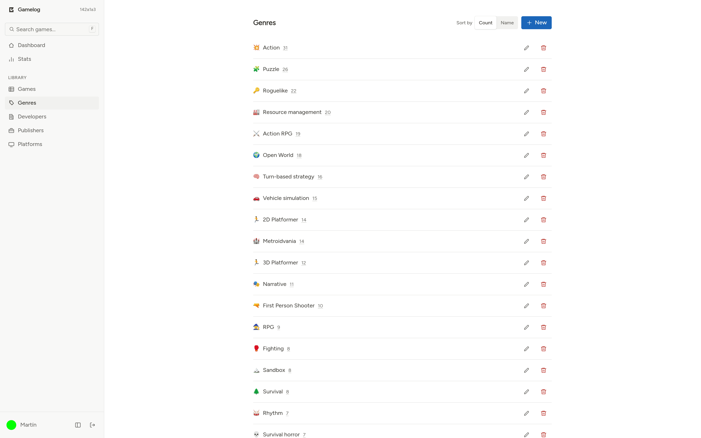
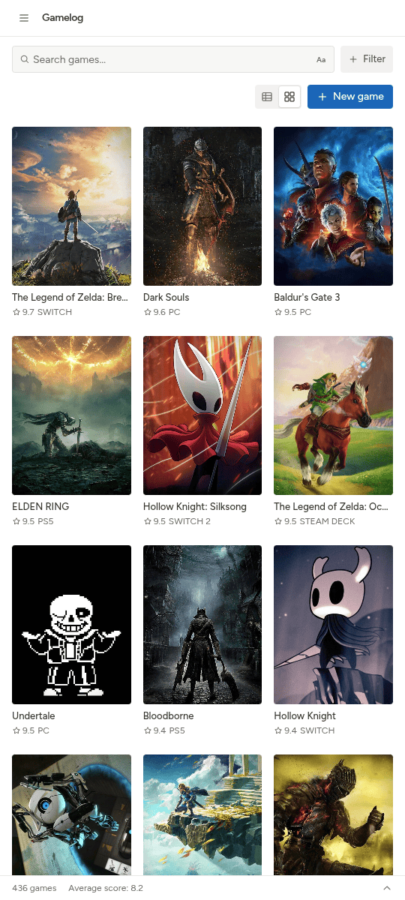
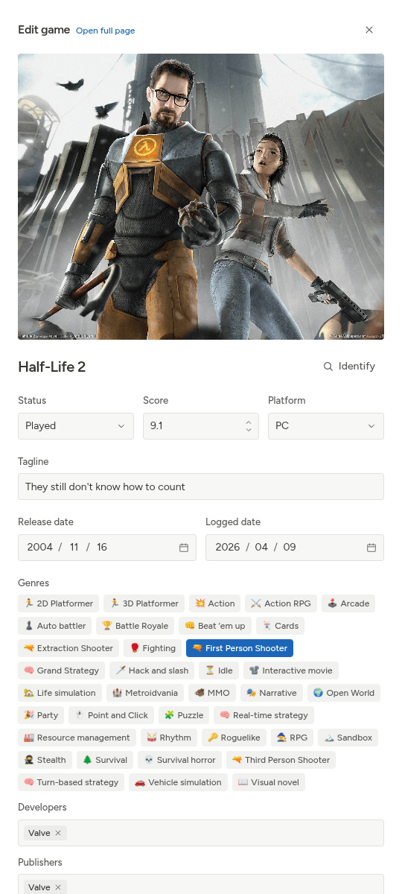
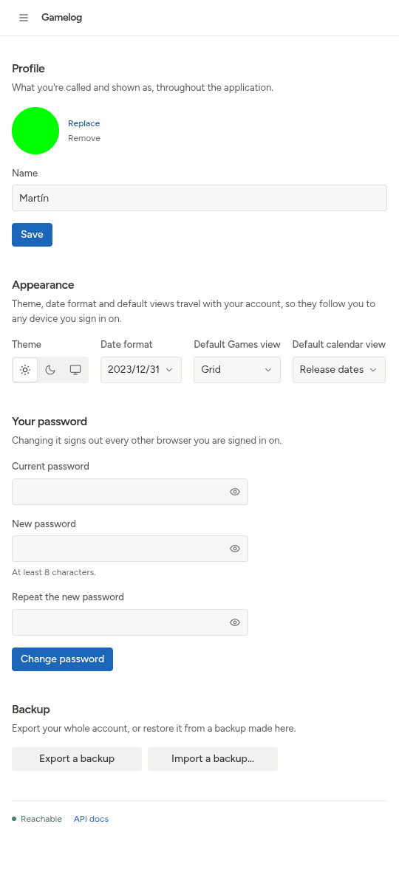

# Screenshots

A tour of the main screens, on desktop and on a phone, in the theme your browser prefers, light or dark. Every one of them is also shown in both themes side by side on [All screenshots](screenshots-all.md).

## Desktop

### Dashboard

The home page. "Coming up" counts down to the next game due out and lists the ones after it. Below, the library is laid out as a board with one column per status (Wishlist, Pending, Playing and Played), next to a calendar of release dates.

<picture>
  <source media="(prefers-color-scheme: dark)" srcset="screenshots/desktop/dashboard-dark.png">
  
</picture>

### Stats

What has been played, year by year, with the average score underneath, a breakdown by platform, genre, developer or publisher, the spread of scores and how long after release games were played. Here the Action RPG genre is picked out in every chart.

<picture>
  <source media="(prefers-color-scheme: dark)" srcset="screenshots/desktop/stats-dark.png">
  
</picture>

### Games as a cover grid

The games list shown as covers, here filtered by genre, with the score and platform under each one. The footer sums up the filtered games: how many there are, their average score and the span of their release and logged dates.

<picture>
  <source media="(prefers-color-scheme: dark)" srcset="screenshots/desktop/games-grid-dark.png">
  
</picture>

### Games as a table

The same list as a table, here filtered by platform and sorted by score, with the status, genres, developers, publisher and both dates of each game.

<picture>
  <source media="(prefers-color-scheme: dark)" srcset="screenshots/desktop/games-table-dark.png">
  
</picture>

### Editing a game

Opening a game slides in a panel over the current page, with its cover, status, score, platform, tagline, dates, genres, developers and publishers, and an Identify button that fills them in from IGDB. It can also be opened as a full page.

<picture>
  <source media="(prefers-color-scheme: dark)" srcset="screenshots/desktop/edit-game-dark.png">
  
</picture>

### Genres

Genres, developers, publishers and platforms each have their own page, sorted by name or by how many games use them, where they can be added, renamed and deleted.

<picture>
  <source media="(prefers-color-scheme: dark)" srcset="screenshots/desktop/genres-dark.png">
  
</picture>

## Mobile

<table>
  <tr>
    <td width="33%" valign="top">
      <picture>
        <source media="(prefers-color-scheme: dark)" srcset="screenshots/mobile/games-grid-dark.png">
        
      </picture>
      
<b>Games.</b> The sidebar folds into a menu and the cover grid fits three games per row.

    </td>
    <td width="33%" valign="top">
      <picture>
        <source media="(prefers-color-scheme: dark)" srcset="screenshots/mobile/edit-game-dark.png">
        
      </picture>
      
<b>Editing a game.</b> The edit panel takes up the whole screen.

    </td>
    <td width="33%" valign="top">
      <picture>
        <source media="(prefers-color-scheme: dark)" srcset="screenshots/mobile/account-dark.png">
        
      </picture>
      
<b>Account.</b> Profile, theme, date format, default views, password and backups.

    </td>
  </tr>
</table>
